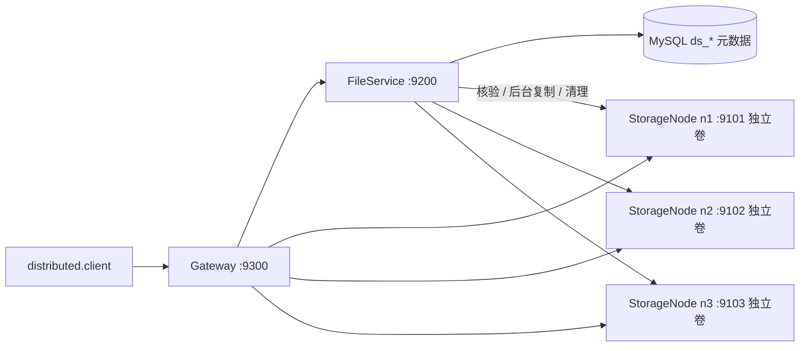
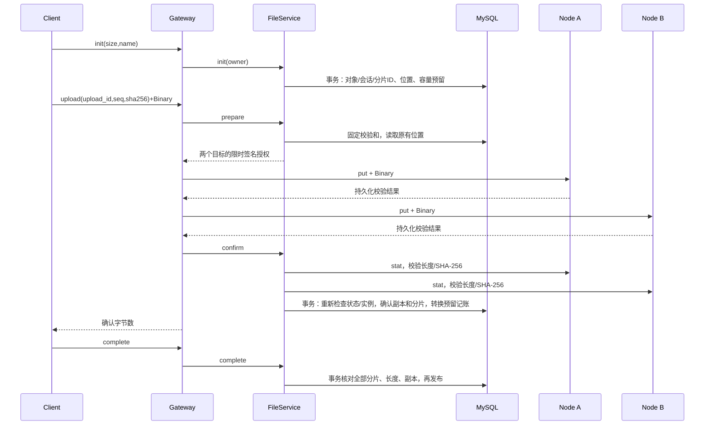

# 分布式模式（独立于旧 C++ 模式）

新增 Python 标准库实现，使用 libmysqlclient 连接 MySQL，沿用现有 24B v1 Header + JSON + Binary（CRC32）协议。旧 C++ 代码、旧表及旧数据不变。旧协议中的 filepath 不适用于新模式；新客户端仅使用逻辑标识。实现过程中各阶段测试与限制记录在本文。

第一阶段：database/migrations/001_distributed.sql 添加独立 ds_* 表；`python3 -m distributed.migrate` 在选定的 FS_DB_NAME 上按版本应用迁移。空库和已有库均使用该命令；不删除旧表。DDL 自动提交，失败可重跑未记录的版本。不要通过删除 ds_* 表回退生产数据；回退程序至旧模式，保留新表和节点目录。

分片写入依次校验授权、长度、SHA-256，循环 write（重试 EINTR，拒绝零写入），fsync 文件，原子 link 发布（不覆盖已有文件），删除临时名，fsync 目录。link 提供与不覆盖 rename 等价的原子发布；相同内容重试还会同步目录。仅 write/close 不视为持久化。以上依赖操作系统和底层文件系统兑现 fsync，不宣称验证真实断电。目录独占锁阻止同一目录双实例；目录身份中保存 node_id 和 volume，启动生成新的 instance。启动清理目录内遗留临时文件。

## 运行与验收

设置至少 24 字符的 `DS_SERVICE_KEY`，以及 JSON 格式 `DS_USERS='{"alice":"至少24字符的用户令牌"}'`。配置 `FS_DB_*` 后先运行 `python3 -m distributed.migrate`，再启动三个节点、FileService、Gateway；可使用 `scripts/distributed-local.sh` 或 `docker compose -f distributed/compose.yml up`。三个本机进程使用不同端口和目录，只能模拟进程故障，不能验证整机或物理盘故障。

客户端示例：`DS_OWNER=alice DS_TOKEN=... python3 -m distributed.client upload ./big.bin --checkpoint .upload.json`；中断后使用 `resume`，下载使用 `download OBJECT_ID output.bin`，删除使用 `delete OBJECT_ID`。上传按 4 MiB 分片、有限并发发送，状态以已确认分片求和；零字节对象没有分片，`complete` 直接发布。对象 ID 独立，同名对象不会覆盖。

FileService 的 MySQL 元数据是单点；FileService 或 MySQL 故障时控制面不可用。已发布对象在一个节点失联时可从另一个副本下载。后台任务使用租约可重领；修复只在发布状态、任务令牌仍有效且目标副本不存在时确认。删除先将对象标记为 deleted，再清理副本，避免修复复活对象。所有副本不可用返回 `DATA_UNAVAILABLE`，保留元数据。

当前环境未运行真实 MySQL/Gateway 多进程验收：启动 mysqld 绑定本地 TCP 被沙箱拒绝；真实断电和物理磁盘故障也未测试。已运行：`python3 -m unittest distributed.tests.test_storage -v`（3 项通过）、`python3 -m py_compile distributed/*.py`。旧 C++ 测试未被改动。

## 架构和上传时序



FileService 只通过节点 RPC 核验及安排复制，不访问任何节点目录；原型后台复制经过其工作进程的有界分片缓冲。Gateway 和 FileService/MySQL 都是集中服务，没有 Raft、纠删码、POSIX、RDMA 或元数据 HA。不具备跨节点与 MySQL 的分布式事务。



## 状态和事务

| 实体 | 状态与合法转换 |
|---|---|
| 上传 | uploading → completed / cancelled / expired；completed 不能再次写入；删除可将其变为 cancelled |
| 对象 | staging → published → deleted；staging → deleted；deleted 为终态 |
| 分片 | pending → confirmed；内容校验和首次 prepare 后固定，发布后不可改变 |
| 副本 | reserved → valid → bad/unverified；unverified 经 stat → valid/bad；清理 → deleting → gone |
| 节点 | healthy → suspect → unavailable；当前实例心跳可恢复 healthy，新实例需旧租约超时并重新核验 |
| 任务 | pending → running(令牌/租约) → done；失败退避至 pending；租约过期可重新领取 |

所有容量变化和对象生命周期操作先锁 `ds_allocator` 的持久化行，再锁会话/对象/节点。单行串行化适合原型，限制吞吐；不依赖 Python mutex 提供数据库一致性。初始化对所有预期分片一次事务预留；不足会整体回滚。相同 upload_id/seq 由唯一约束映射同一分片和位置。确认按实际 confirmed 分片求和，不使用最大偏移；重复确认不重复转换容量。每个对象保存 chunk_size/replicas，默认配置改变不影响旧对象。

网络操作在事务外；确认和修复在第二个事务再次核验。发布和删除共用锁顺序，逻辑删除立即阻止读取和确认。删除任务延迟至少授权有效期加 30 秒，避免有效授权尚在执行时清理。节点 RPC 超时 10 秒，客户端连接错误最多重试三次，操作标识保持不变。旧实例一旦退休，后续延迟心跳被拒绝。相同目录有 flock 排他锁，不同目录相同 node_id 由注册租约互斥。

`ds_replicas.charged` 区分 reserved、used、none，记录容量转换。删除物理数据 ACK 后扣除 used，重复执行不重复扣减；取消/过期回收预留。节点容量及实际可用空间一起参与放置；节点写入还在容量锁内重新检查实际文件总量。

## 表与迁移

| 表 | 主要字段/约束 |
|---|---|
| ds_objects | object_id 主键、owner/name/size/chunk_size/replicas/state；owner,state 索引 |
| ds_uploads | upload_id 主键、object_id 唯一外键、state/expires 索引 |
| ds_chunks | chunk_id 主键、upload_id+seq 唯一、length/sha256/state |
| ds_replicas | chunk_id+node_id 联合主键，volume/state/charged；node_id,state 索引 |
| ds_nodes | node_id 主键，address/instance/volume/heartbeat/capacity/free_bytes/reserved/used_bytes/state |
| ds_instances | node_id+instance 主键，保留退休实例，拒绝迟到注册 |
| ds_tasks | 自增主键，kind+chunk_id+node_id 唯一；state,lease 索引，token/attempts/reason |
| ds_allocator / ds_schema_version | 事务容量锁 / 已应用版本 |

执行顺序 `001_distributed.sql` → `002_replica_accounting.sql`，使用 `python3 -m distributed.migrate`，不要只重跑旧 schema.sql。新增列通过 ALTER 升级；迁移器支持 ALTER 成功而版本记录尚未完成后的重跑。上线迁移应停止分布式服务，备份数据库；不支持新数据降级到旧表。

旧 C++ 客户端和数据仍使用原运行方式；新模式不读取旧 filepath。迁移旧内容的方法是：用原客户端下载到本地，再用新客户端 upload，核验下载 SHA-256 后人工决定是否删除旧对象。不得直接把旧共享目录挂到新节点冒充副本。

## 接口和安全

所有响应 JSON 顶层 `code="OK"` 表示成功，否则 `code` 为错误字符串，`message` 描述错误。二进制数据只在既有 Binary 字段中，绝不 Base64。每个连接一个请求/响应，避免旧异步 RPC promise 生命周期问题。用户接口都需要 `owner` 和 `token`，原型使用配置的独立用户凭据，不复用旧 MD5 登录。

| 服务 | cmd | 主要请求 → 响应 |
|---|---|---|
| Gateway | init | name,size → object_id,upload_id,chunk_size,chunks |
| Gateway | upload | upload_id,seq,sha256 + Binary → confirmed_bytes |
| Gateway | status | upload_id,cursor → state,confirmed_bytes,missing,next_cursor,size,chunk_size |
| Gateway | complete / cancel | upload_id → object_id/state 或 state |
| Gateway | manifest | object_id → name,size,chunk_size,chunks |
| Gateway | download | object_id,seq → length,sha256 + Binary |
| Gateway | delete | object_id → deleted |
| FileService 内部 | prepare / confirm | 可信 owner,upload_id,seq,sha256 → 授权位置 / 进度 |
| FileService 内部 | heartbeat | node_id,instance,volume,capacity,free_bytes → instance |
| Storage 内部 | put | chunk_id,authorization + Binary → length,sha256 |
| Storage 内部 | stat / get | chunk_id,length,sha256 → 校验信息 / Binary |
| Storage 内部 | inventory | cursor → ids,more（每页 256） |
| Storage 内部 | remove | chunk_id,instance,volume → 幂等结果 |

内部接口必须有 `service_key`。写授权 HMAC 绑定 upload_id、chunk_id、目标 node_id/volume/instance、长度、SHA-256 和到期时间。Gateway 明确筛选外部字段；外部不能提交节点地址、路径或内部确认命令。部署网络必须隔离，当前原型没有 TLS，服务凭据可被受信网络中的监听者看到，不可直接暴露公网。

错误包括 AUTH、FORBIDDEN、INVALID、LIMIT、PROTOCOL、TRUNCATED、CHECKSUM、CONFLICT、EXPIRED、DELETED、NOT_FOUND、NOT_PUBLISHED、INCOMPLETE、CAPACITY、UNAVAILABLE、DATA_UNAVAILABLE、STALE、DUPLICATE、BUSY。意外异常受控返回 INTERNAL，不返回成功。

JSON 上限 1 MiB，Binary 上限 4 MiB，单服务并发 32、等待连接队列 32；每个上传默认最多 8192 分片，缺片/库存每页 256。后台任务用唯一键去重。数据库任务和对象总数目前无全局配额，是原型限制。

## 配置

`FS_DB_HOST/PORT/USER/PASS/NAME/SOCKET` 配置数据库；运行迁移和服务须一致。没有把秘密提交到仓库。

| 配置 | 默认 |
|---|---|
| DS_SERVICE_KEY / DS_USERS | 必须配置至少24字符的服务密钥和用户 token 映射 |
| DS_NODES | n1:127.0.0.1:9101, n2:9102, n3:9103（实际为 JSON 映射） |
| DS_FILE_ADDRESS / DS_GATEWAY_ADDRESS | 127.0.0.1:9200 / 127.0.0.1:9300 |
| DS_CHUNK_SIZE / DS_REPLICAS | 4194304 / 2 |
| DS_CAPACITY | 每节点 1 GiB |
| DS_UPLOAD_TTL / DS_AUTH_TTL | 86400 / 30 秒 |
| DS_HEARTBEAT_SECONDS / DS_SUSPECT_SECONDS / DS_DEAD_SECONDS | 1 / 5 / 15 秒 |
| DS_REPAIR_WORKERS / DS_REPAIR_BPS / DS_TASK_LEASE | 1 / 8 MiB/s 聚合预算 / 120 秒 |
| DS_MAX_CHUNKS | 8192 |

连接/请求超时目前固定 10 秒、并发/消息上限固定，尚未全部配置化。参数范围在启动时校验。`DS_FAULTS=write,sync` 在节点注入磁盘错误，`confirm` 在 FileService 注入元数据确认失败，`response` 在 Gateway 注入确认完成后响应失败；`no_worker` 仅供测试固定故障窗口。

## 故障恢复

节点疑似超时先从可读位置过滤；持续不可用记录 unavailable，不能等同永久丢失。扫描已发布对象后为不足副本创建持久化修复任务；没有源或目标时任务保持 pending 并记录 reason。先保留源，复制并校验目标后再发布位置。任务令牌、有效租约、文件状态、节点实例和预留状态全部满足才提交。修复请求失败后复用 reserved 目标，不再次增加预留。旧节点恢复后分页对账、核验 unverified，足够健康副本存在后才删除额外/过期数据。

每次启动清理 .tmp-*；周期 inventory 为逻辑删除后的迟到文件重新创建清理任务。持久化任务租约过期可重领，进程内线程退出不会丢失任务。后台网络和维修等待不持有数据库锁。原型扫描尚未对总对象数分页，节点本地目录也会扫描容量，适合有限规模实验。

## 可复现演示

```bash
export DS_SERVICE_KEY='replace-with-a-private-service-key'
export DS_USERS='{"demo":"replace-with-a-private-user-token"}'
export DS_DB_PASSWORD='replace-with-a-database-password'
docker compose -f distributed/compose.yml up --build -d
export DS_OWNER=demo DS_TOKEN='replace-with-a-private-user-token'
python3 -m distributed.client upload ./input.bin --checkpoint ./upload.json
# 保存输出 object_id。中断可用 resume ./input.bin UPLOAD_ID
python3 -m distributed.client download OBJECT_ID ./output.bin
sha256sum input.bin output.bin
docker compose -f distributed/compose.yml stop node1
python3 -m distributed.client download OBJECT_ID ./after-failure.bin
# 等待后台补副本，再恢复旧节点并等待对账
docker compose -f distributed/compose.yml start node1
python3 -m distributed.client delete OBJECT_ID
```

停止部署使用 `docker compose -f distributed/compose.yml down`，保留数据卷。不要运行 down -v，除非确实要删除该 Compose 项目的数据。脚本退出只停止自己创建的进程，绝不清理用户目录。

## 验证记录（以本节覆盖早期阶段记录）

真实 MySQL 8.0.46 + 真实五个服务子进程、独立临时节点目录：7 组集成测试已通过（约 6 秒），涵盖零字节/单片/整倍数/短尾、并行及重复上传冲突、服务重启续传、元数据故障、响应失败后重试、权限与删除取消、单节点失联读取及补回双副本、单副本损坏切换、全部损坏明确不可用。集成测试用 4096 字节分片加速执行，默认 4 MiB 尚未执行同样的整套场景。存储3项测试通过；后续无需网络的2项再次通过。C++ 原单元、协议、线程池10000任务测试通过，原数据库相关测试写死用户数据库连接，未运行以避免污染。

扩展新增测试（test_08 至 test_10）覆盖取消预留回收、过期、重复实例、非法长度及删除任务崩溃恢复，**尚未执行**：工具权限请求被用户拒绝。此后仅进行了静态检查和本地存储测试；不能把后续变更称为完成集成验收。Compose 未实跑，本机没有 Docker。真实断电、旧盘替换、修复/删除竞争压力及全局容量长期对账还需补充验证。

主要验收命令（失败非零）：先在隔离 MySQL 中创建一个空的 `ds_test_*` 数据库，然后：

```bash
FS_DB_HOST=127.0.0.1 FS_DB_PORT=13316 FS_DB_USER=root FS_DB_PASS=... \
DS_TEST_DATABASE=ds_test_acceptance scripts/test-distributed.sh
```

测试拒绝非 ds_test_* 或非空数据库，不删除数据库，保留元数据供诊断；仅自动删除自己创建的临时目录。故障注入证明错误传播和重试语义，不等同真实断电。
